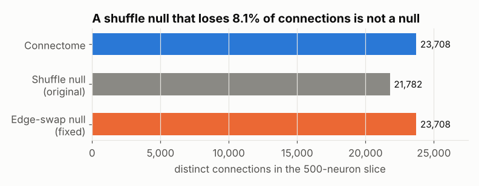
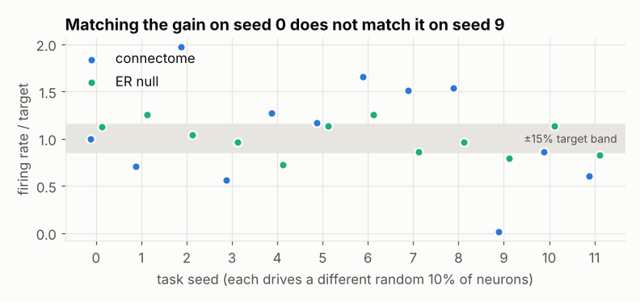
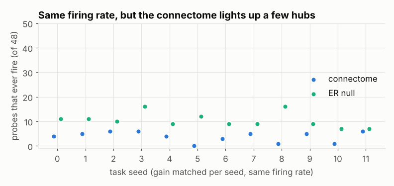
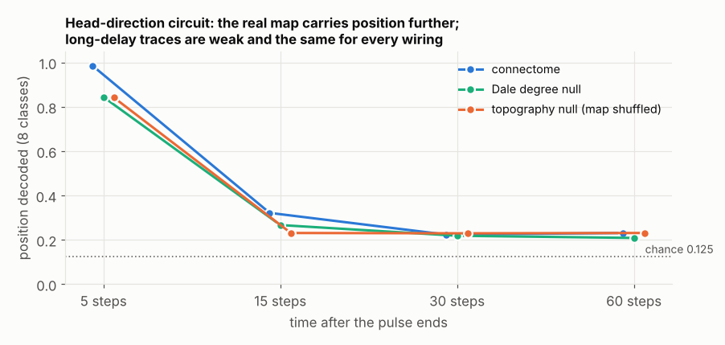

# Fly Lab

**Does the fruit fly's wiring diagram compute anything a random one wouldn't? Six
preregistered experiments on two connectomes (MaleCNS, 165,122 neurons; FlyWire, 127,400): a "no"
for generic wiring, a clear "yes" where anatomy predicts one, and a published whole-brain model
prediction replicated on an independent connectome — with the audits that kept each answer
honest.**

[](https://github.com/coder058/fly-brain/actions/workflows/ci.yml)
· Python 3.12/3.13 · CPU-only · MIT (code) / CC-BY 4.0 (data)


## In 60 seconds

**1. A whole-brain model, rebuilt and checked against the original.** I re-implemented the
spiking whole-brain model of [Shiu et al., *Nature* 2024](https://doi.org/10.1038/s41586-024-07763-9)
in vectorised NumPy ([`flylab/brain.py`](flylab/brain.py)). It is **spike-for-spike identical
to their Brian 2 equations** (tested in CI), and on their FlyWire data it **reproduces their
published simulations neuron by neuron (r = 0.9998; MN9 92.5 vs 93.3 Hz)**. Getting to exact
equality surfaced two Brian 2 semantics that a re-implementation from the paper alone gets
wrong. → [validation](reports/SIMULATOR_VALIDATION.md)

**2. A published prediction, tested on a second fly.** Shiu et al. predicted from FlyWire
(one female brain) that sugar-sensing neurons drive MN9, the motor neuron that extends the
proboscis. I preregistered the same test on MaleCNS — a different animal, sex, lab and
pipeline. **It replicates: MN9 95.4 Hz [91.5, 99.3] vs 0 Hz unstimulated**, and on three
whole-brain rewirings that keep every neuron's degrees, weights and transmitter sign it drops
to **0.0 Hz**. Then I audited the win: on MaleCNS the same model excites ~20,500 neurons
instead of ~490, one of the two MN9s is an incompletely traced reconstruction, and one of my
own endpoints matched cell types by name when the two datasets name them differently. All
three are in the report, next to the verdict. → [EXP-W1-SUGAR](reports/EXP_W1_SUGAR.md)

**3. Before that: the generic question, answered "no".** Turning hub-selected 500-neuron
slices of MaleCNS into reservoirs, I asked whether real wiring carries a temporal signal better
than random graphs. Six audits each found a bug in my own instrument that changed the answer
(a leaking readout, a null that deleted 8% of edges, a control that broke Dale's law, …). From
the second audit on, every fix was preregistered and pushed before it ran. **Final answer: not
supported** (+0.004 [−0.014, +0.022] vs a Dale-preserving rewiring on one slice, −0.116 on the
other).

**4. …and the same instrument does see structure where anatomy predicts it.** On the
head-direction circuit (152 neurons wired as a map of heading), real wiring carries position
far better than the same circuit with its map shuffled: **+0.143 [+0.135, +0.151], 24/24 seeds.**

What this project demonstrates is not a discovery about flies. It is a measurement practice:
validate the instrument against ground truth, preregister, use null models that keep
everything but the thing being tested, and keep auditing a result after it comes out the way
you hoped.

Full story: **[docs/CASE_STUDY.md](docs/CASE_STUDY.md)**.

## Why I built this

Connectomes are now complete enough to download as graphs, and "brain-inspired architecture"
is an easy claim to make and a hard one to test. I wanted to find out what it actually takes to
answer *"is this structure useful?"* without fooling myself — because in ML and science alike,
the expensive mistakes are the convincing results that come from the measuring instrument
rather than the thing being measured. This project is my practice ground for that: real data at
scale, strong null models, positive controls, preregistration, and publishing the answer the
data gives.

## Try it (no 1 GB download needed)

```bash
git clone https://github.com/coder058/fly-brain && cd fly-brain
pip install -r requirements.txt matplotlib
python -m flylab.demo           # ~30 s: reproduces the bugs on real connectome data, redraws every figure
python -m pytest -q             # ~120 tests
```

The demo runs on [`data/e1_slice/`](data/e1_slice): the exact 500-neuron slices the experiments
used (70 KB and 38 KB, SHA-256 checked; the main one is tested equal, edge for edge, to the
extraction from the full graph).

Reproduce any experiment with the command in its protocol (≈ 20–35 min each on 4 cores). A fresh
clone reproduced all 3,960 result rows of EXP-E1-OP exactly; rebuilt from raw data on another
machine, the original September run reproduced to every digit.

Rebuild everything from Janelia's raw files (≈ 5 min, 16 GB RAM):

```bash
python scripts/download_malecns.py                       # 1.1 GB, SHA-256 verified
python scripts/build_graph.py --out-dir data/derived/graph_check
# -> 165,122 neurons, 25,563,197 connections, 124,025,046 synapses (matches the record exactly)
```

## Whole-brain model: validation and cross-connectome replication

| check | result |
|---|---|
| vs Brian 2 (the original simulator), 3 random signed networks | every spike on the same 0.1 ms step ([test](tests/test_brain.py)) |
| vs Shiu et al.'s published FlyWire outputs, sugar 200 Hz / 100 Hz | MN9 92.5 vs 93.3 / 67.5 vs 67.0 Hz; per-neuron r = 0.99985 / 0.99978; 49/50 and 50/50 top responders shared ([SHIU-REPRO](reports/SIMULATOR_VALIDATION.md)) |
| **EXP-W1-SUGAR** (preregistered): MaleCNS, LB3c sugar GRNs 200 Hz | **MN9 95.4 Hz [91.5, 99.3]**; 0 Hz input → 0.0 Hz; monotone dose response |
| same, three whole-brain Dale-preserving rewirings | MN9 **0.0 / 0.0 / 0.0 Hz** — the pathway is in the wiring |
| FlyWire's 30 strongest responder types, matched through MaleCNS's `flywireType` (post hoc) | **30 / 30 fire** in MaleCNS (by name only, as preregistered: 4 / 30) |
| how far activity spreads, 200 Hz | MaleCNS ~20,500 neurons vs FlyWire ~490: the transferred model is much more excitable |

Reproduce: `bash scripts/fetch_shiu_flywire.sh` (Shiu et al.'s FlyWire table, not
redistributed here), then the commands in the [protocol](experiments/results/EXP-W1-SUGAR/protocol.md)
(≈ 10 min per MaleCNS condition on 4 cores; FlyWire ≈ 1–2 min).

## Reservoir experiments (E1): what the bugs looked like

| | |
|---|---|
|  | **The null that wasn't.** Shuffling connection endpoints and rebuilding a sparse matrix lets SciPy merge duplicates: 8% of connections vanish. Replaced by a directed double-edge swap that preserves every degree exactly ([`flylab/nulls.py`](flylab/nulls.py)). |
|  | **One gain for every input.** Each seed drives a different 10% of neurons. A random graph doesn't care; the hub-heavy connectome swings from 0.1× to 3.3× the target activity. Fixed by matching activity per seed. |
|  | **A readout looking the wrong way.** At equal firing rate about 37 of 450 neurons carry the connectome's activity (a random graph: ~100), and 48 random probes see ~4 of them. Fixed by reading every non-input neuron. |
| | **A control that broke Dale's law.** The degree null's weights followed the receiving neuron, not the sender, so 479 of 500 neurons ended up both exciting and inhibiting. Same edges, weights kept on the sender: the null loses 5 points on 24/24 seeds ([`weights_follow="pre"`](flylab/nulls.py)). |
| | **A matcher too coarse for the connectome.** Gain was tuned on 20 trials to ±15%; on slice B the connectome's full-set rate then landed at 0.7×–4.4× of target and 11/24 seeds were lost. Matching on all training trials to ±5% lost 1/24. |

## Reservoir experiments (E1): results

Every confirmatory comparison, preregistered, 24 fresh seeds each, 20 draws of every null,
firing rate matched per seed (±15%), full non-input readout. Accuracy on a 5-class task
(chance 0.20). Paired difference connectome − control, 95% CI.

| experiment | slice | vs Erdős–Rényi | vs degree null (mixes signs) | vs degree null (Dale's law kept) |
|---|---|---|---|---|
| [E1-OP](reports/EXP_E1_OP.md) | A | +0.081 [+0.063, +0.100] | −0.036 [−0.057, −0.016] | — |
| [E1-DALE](reports/EXP_E1_DALE.md) | A | +0.101 [+0.080, +0.123] | −0.021 [−0.045, +0.002] | +0.028 [+0.008, +0.049] |
| [E1-REPL](reports/EXP_E1_REPL.md) | B | *instrument incomplete (13/24 seeds)* | | |
| [**E1-MATCH**](reports/EXP_E1_MATCH.md) (final) | **A** | **+0.080 [+0.060, +0.099]** | — | **+0.004 [−0.014, +0.022]** |
| [**E1-MATCH**](reports/EXP_E1_MATCH.md) (final) | **B** | **−0.051 [−0.098, −0.004]** | — | **−0.116 [−0.163, −0.069]** |

Slice A: the 500 highest out-degree neurons. Slice B: neurons ranked 501–1000, disjoint.
A no-network baseline (linear readout of the raw input) scores 0.83–0.84; the connectome beats
it on slice A (+0.033 [+0.012, +0.055]) and falls below it on slice B (−0.092 [−0.138, −0.045]).

**What it means.** On this task and neuron model, there is no evidence that the fly's specific
wiring carries the signal better than a rewiring with the same degrees, weights and signs. Its
advantage over a fully random graph is real on one slice and reversed on another, so it is a
property of *which* neurons you take, not of fly wiring in general.

**What it does not mean.** That connectome wiring is useless. One simple task, a leaky
integrate-and-fire model with synapse counts as weights, and two hub-selected slices of 500
neurons (0.3% of the CNS each) is a narrow probe; on slice A, 243 of 500 neurons have no
confident transmitter prediction and send zero-weight outputs.

How much each instrument fix mattered on slice A is shown in the
[EXP-E1-OP 2×2](reports/EXP_E1_OP.md) and in
[`figures/fig4_e1_op_result.png`](figures/fig4_e1_op_result.png).

## Sensitivity check: a circuit with a known function



A degree-ranked slice has no reason to compute anything in particular, so a "no" there could
just mean the instrument is blind. [EXP-E2-HD](reports/EXP_E2_HD.md) tests the same pipeline on
the head-direction circuit (EPG, PEN, PEG and Delta7 neurons, with Delta7 inhibition kept), in
which neurons are wired according to the heading they represent. A pulse marks one of eight
positions; a readout that never sees the stimulated neurons must recover it later. Every graph
gets the same tuning budget (a fixed gain grid, chosen on training trials only).

| time after pulse | connectome | Dale degree null | map-shuffled null (keeps every type→type count) | connectome − map-shuffled |
|---|---|---|---|---|
| 5 steps | **0.984** | 0.844 | 0.841 | **+0.143 [+0.135, +0.151]**, 24/24 seeds |
| 15 steps | 0.322 | 0.267 | 0.231 | +0.091 [+0.073, +0.108] |
| 30 / 60 steps | 0.22 / 0.23 | 0.22 / 0.21 | 0.23 / 0.23 | ≈ 0 |

Chance is 0.125. A finer gain grid (post hoc) gives the same answer. Under this simple neuron
model the circuit never holds a persistent "bump" of activity, so this is a transmission result:
the map makes neurons that encode the same position converge on shared targets.

## Repository map

| path | what |
|---|---|
| [`flylab/brain.py`](flylab/brain.py), [`connectomes.py`](flylab/connectomes.py) | whole-brain LIF model (Shiu et al.), batched and active-set kernels; FlyWire 630 and MaleCNS loaders |
| [`flylab/`](flylab) | library: graph loading, LIF dynamics, nulls (degree, Dale, map-shuffling block null), spectral gain, bundled slices and circuit, the demo |
| [`experiments/harness/`](experiments/harness) | runners: [`e1_operating_point.py`](experiments/harness/e1_operating_point.py) (all E1 experiments), [`hd_memory.py`](experiments/harness/hd_memory.py) (EXP-E2-HD), [`shiu_reproduction.py`](experiments/harness/shiu_reproduction.py), [`sugar_mn9.py`](experiments/harness/sugar_mn9.py) + [`sugar_analysis.py`](experiments/harness/sugar_analysis.py) (EXP-W1-SUGAR) |
| [`experiments/results/`](experiments/results) | append-only results with their protocols (`EXP-E1-OP`, `-DALE`, `-REPL`, `-MATCH`, `EXP-E2-HD`, `SHIU-REPRO`, `EXP-W1-SUGAR`) |
| [`reports/`](reports) | audits, errata and one report per experiment |
| [`tests/`](tests) | unit tests for nulls (both weight conventions), leakage, liveness, determinism, slices and the runner |
| [`RESEARCH_LEDGER.yaml`](RESEARCH_LEDGER.yaml) · [`SCIENTIFIC_CLAIMS.md`](SCIENTIFIC_CLAIMS.md) | every experiment ID and what may be claimed from it |
| [`research/`](research), [`anomaly/`](anomaly) | earlier exploratory tracks (motif mining, routing, anomaly detection); see the ledger |
| [`docs/lab-notebook/`](docs/lab-notebook) | raw working notes from the experiment loop, kept for transparency |

Other experiments (memory, ignition, glutamate polarity, motif controls) are recorded in the
ledger with their outcomes — mostly instrument failures the harness refused to score. None is a
positive result.

## How this was built

Solo project on a 2-vCPU cloud VM, then a 4-core container; no GPU. AI coding assistants were
used as pair programmers and as adversarial reviewers — several of the bugs above were found by
asking one to audit the code line by line as hostilely as possible. Every experiment was gated
by a written protocol pushed before it ran, and every number in this README comes from a result
file in the repository.

## Data and license

Code: MIT. Data: [MaleCNS v1.0](https://male-cns.janelia.org/), Janelia FlyEM, CC-BY 4.0; the
files under `data/` are subsets of it. See [`data/README.md`](data/README.md).
