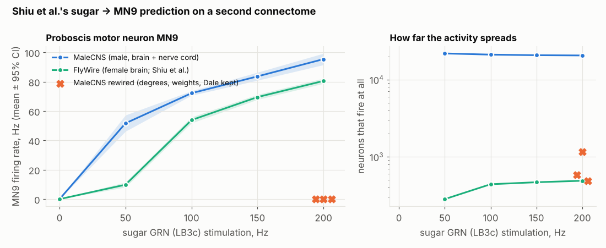

# EXP-W1-SUGAR — report

Protocol: [`experiments/results/EXP-W1-SUGAR/protocol.md`](../experiments/results/EXP-W1-SUGAR/protocol.md),
pushed as `4e0550e` (2026-10-25 11:29:44 UTC) before any MaleCNS sugar simulation ran.
Analysis: [`sugar_analysis.py`](../experiments/harness/sugar_analysis.py) →
[`analysis.json`](../experiments/results/EXP-W1-SUGAR/analysis.json). Artifacts:
`sugar_malecns-both_…_b55a2b4.json`, `sugar_malecns-lateral_…_1b37138.json`,
`sugar_flywire_…_06d258b.json` (all three runs carry the same runner hash `5ac4ae20…`).

**Question.** Shiu et al. (Nature 2024) built a whole-brain spiking model on the FlyWire
connectome and predicted that sugar-sensing neurons drive MN9, the motor neuron that extends
the proboscis — a prediction they then confirmed in real flies. Is that prediction a property
of the fly's circuit, or of one particular reconstruction? MaleCNS is an independent one: a
different (male) animal, a different lab and pipeline, and it includes the nerve cord.

## Outcome

**Primary: replicates.** MaleCNS, all 23 LB3c sugar GRNs at 200 Hz, 30 trials:
**MN9 95.4 Hz, 95% CI [91.5, 99.3]**; with no stimulation MN9 is silent (0.0 Hz). The
preregistered rule ("lower bound > 10 Hz and 0 Hz mean < 2 Hz") is met by a wide margin.

| | 0 Hz | 50 Hz | 100 Hz | 150 Hz | 200 Hz |
|---|---|---|---|---|---|
| MaleCNS, LB3c both sides — MN9 | 0.0 | 51.7 | 72.2 | 83.6 | **95.4** |
| MaleCNS — neurons that fire | 0 | 21,838 | 21,080 | 20,717 | 20,559 |
| FlyWire 630, LB3c both sides — MN9 | 0.0 | 9.8 | 53.9 | 69.5 | 80.5 |
| FlyWire — neurons that fire | 0 | 282 | 440 | 467 | 488 |
| FlyWire, Shiu et al.'s 21 inputs — MN9 | 0.0 | 20.7 | 67.1 | 83.4 | 93.1 |
| MaleCNS rewired ×3 (Dale degree null), 200 Hz — MN9 | | | | | **0.0, 0.0, 0.0** |

**Secondary endpoints.**

1. *Dose response:* Spearman ρ = 1.0 over the five rates (monotone).
2. *Laterality:* inconclusive for a reason found in the data (below). Left-only input:
   0 / 42.0 / 36.2 / 53.6 / 74.0 Hz; right-only: 0 / 60.3 / 69.7 / 75.3 / 84.0 Hz. Whichever side
   is stimulated, MN9_L fires 4–8× more than MN9_R (e.g. right-only at 200 Hz: 147.0 vs
   20.9 Hz).
3. *FlyWire comparator:* the LB3c-only input gives the same qualitative result (80.5 Hz at
   200 Hz). Shiu et al.'s original 21 inputs give 93.1 Hz (their published value: 93.3 Hz).
4. *Responder overlap (preregistered, by type name):* **4 of 30** top FlyWire responder types
   have a same-named MaleCNS type above 1 Hz; Spearman over 2,287 shared names ρ = 0.03.
   See "the overlap endpoint was badly specified" below.
5. *Wiring control:* all three whole-brain Dale-preserving degree nulls (every neuron keeps
   its in- and out-degree, its outgoing weights and its transmitter sign; 25,563,096 edges,
   no duplicates or self-loops) give **MN9 0.0 Hz**, below the connectome's lower bound
   (91.5 Hz): *the pathway depends on the wiring*, not on degrees, weights or sign balance.

**Reproducibility.** The first execution was killed by a job-time limit after 14 of 18
conditions (protocol execution note). The rerun, with identical seeds, reproduced every
logged mean of that run to the printed digit (0 / 51.7 / 72.2 / 83.6 / 95.4 Hz; nulls 0.0;
lateral runs likewise), which `sugar_analysis.py` checks.

## What the audit of the result found

A "replicates" verdict with a 40-fold difference in how far activity spreads is not something
to report at face value. Three things turned up.

**1. In MaleCNS the stimulus recruits most of the central brain.** About 20,500 neurons fire
under 200 Hz sugar input, against ≈ 490 in FlyWire. Cell types with a mean rate above 1 Hz
account for ~47% of central-brain intrinsic neurons and ~55% of nerve-cord motor neurons,
while the optic lobe stays silent (~1%). The fastest responders are antennal-lobe local
neurons, mushroom-body output neurons, APL and DPM, at 280–380 Hz — near the model's ceiling
(refractory period 2.2 ms). The rewired graphs activate only 486–1,169 neurons, so the spread,
like MN9's response, depends on the real wiring. MN9 does fire in MaleCNS, but as part of a
near-global excitation, not of a confined pathway as in FlyWire.

**2. The MN9 asymmetry is a reconstruction artifact.** MN9_R has 556 input synapses, MN9_L
6,012; MaleCNS labels MN9_R "RT Hard to trace". The laterality endpoint therefore cannot be
read as biology. The primary endpoint averages the two MN9s as preregistered; MN9_L alone
(156.9 Hz) and MN9_R alone (33.9 Hz) both clear the 10 Hz bar.

**3. The overlap endpoint was badly specified.** It matched cell types by *name*, but most
gustatory-zone types are called CB0xxx in FlyWire and GNGxxx in MaleCNS; MaleCNS records
the correspondence in a separate `flywireType` column (e.g. GNG043 ↔ CB0573, the
interneuron on the two-synapse LB3c → MN9 path in both connectomes). Matching through that
column (**post hoc**): **all 30** top FlyWire responder types map to MaleCNS types, and **all
30 fire** above 1 Hz (most faster than in FlyWire). The rank correlation over all 3,653
mappable types is only ρ = 0.10, because MaleCNS also activates thousands of types that stay
silent in FlyWire. Both numbers are reported; the preregistered one is 4/30.

So the defensible reading: **every element of the sugar → MN9 circuit that the model finds in
FlyWire is also driven in MaleCNS, and rewiring abolishes it — but the transferred model is
far more excitable on MaleCNS**, so the replication is of the pathway's presence, not of its
selectivity.

## Why is MaleCNS so excitable? (post hoc, not preregistered)

Candidate explanations, each tested with the same model and seeds
([`sugar_posthoc.py`](../experiments/harness/sugar_posthoc.py)):

- **Synapse scale.** `w_syn` was tuned by Shiu et al. on FlyWire 630. MaleCNS reports 1.69×
  more input synapses per neuron (median 349 vs 206), so the same per-synapse weight is a
  stronger network.
- **Histamine.** FlyWire's transmitter classifier has no histamine class; MaleCNS's has.
  Shiu et al.'s rule makes histamine excitatory, but it opens chloride channels in flies.
  MaleCNS's 5,910 histaminergic neurons are almost all photoreceptors and optic-lobe cells
  (silent here) plus two central-brain neurons: the GNG043 pair (= CB0573), which FlyWire
  calls dopaminergic. So this check is in effect a test of GNG043's sign.
- **Bottleneck.** Silencing the shared interneuron (FlyWire CB0573; MaleCNS GNG043, and the
  other two-hop candidate DNge031) asks how much of MN9's drive runs through it.

*Results of these post-hoc runs are added when they finish.*

## What it can and cannot show

It shows that a published whole-brain model prediction survives transfer to an independently
reconstructed connectome under the identical model, and that it depends on the specific wiring
(not on degrees, weights or signs). It does not show that the model's dynamics are right on
MaleCNS — the near-global spread says they probably are not without re-tuning — and the
laterality question cannot be answered until MN9_R is fully traced.
