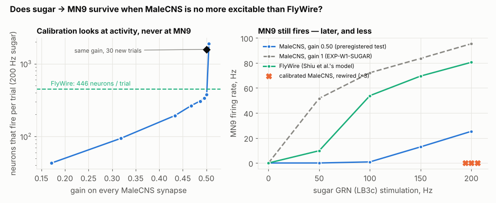

# EXP-W2-CALIB — report

Protocol: [`experiments/results/EXP-W2-CALIB/protocol.md`](../experiments/results/EXP-W2-CALIB/protocol.md),
pushed as `bfc8f59` (2026-10-25 16:44:35 UTC); the run started 7 s later at that commit.
Artifact: `experiments/results/EXP-W2-CALIB/calib_20261025T164442Z_bfc8f59.json`;
endpoints: [`analysis.json`](../experiments/results/EXP-W2-CALIB/analysis.json)
(`sugar_analysis.analyse_calib`).

**Question.** [EXP-W1-SUGAR](EXP_W1_SUGAR.md) replicated sugar → MN9 on MaleCNS, but with
~20,500 neurons firing against ~490 on FlyWire. Does MN9 still respond if MaleCNS is made no
more excitable than FlyWire — with the calibration looking only at how many neurons fire,
never at MN9?

## Outcome

**Primary: survives calibration.** At the calibrated gain s = 0.5008 on every recurrent
MaleCNS weight, LB3c at 200 Hz drives **MN9 at 25.3 Hz, 95% CI [24.5, 26.1]**, 30 fresh
trials; 0.0 Hz without input. The preregistered bar (lower bound > 10 Hz) is cleared.

| | 0 Hz | 50 Hz | 100 Hz | 150 Hz | 200 Hz |
|---|---|---|---|---|---|
| MaleCNS calibrated (s = 0.50) — MN9 | 0.0 | 0.0 | 0.9 | 12.9 | **25.3** |
| MaleCNS calibrated — neurons that fire (any trial) | 0 | 124 | 247 | 339 | 6,873 |
| MaleCNS uncalibrated (EXP-W1-SUGAR) — MN9 | 0.0 | 51.7 | 72.2 | 83.6 | 95.4 |
| FlyWire (Shiu et al.'s model) — MN9 | 0.0 | 9.8 | 53.9 | 69.5 | 80.5 |
| calibrated MaleCNS, rewired ×3 — MN9 | | | | | **0.0, 0.0, 0.0** |

**Secondary endpoints.**

1. *Dose response:* Spearman ρ = 1.0 (monotone), but with a high threshold: MN9 is silent
   up to 50 Hz and barely active at 100 Hz, where FlyWire's MN9 already fires at 54 Hz.
2. *MN9_L / MN9_R:* 50.7 / 0.0 Hz at 200 Hz. The whole response comes from the fully traced
   MN9_L; the incompletely traced MN9_R never fires after calibration.
3. *Responder overlap via `flywireType`:* **22 of 30** top FlyWire responder types fire above
   1 Hz in calibrated MaleCNS (30/30 uncalibrated), most at rates similar to FlyWire's (e.g.
   CB0248 128 vs 133 Hz, CB0118 117 vs 122 Hz, CB0573 68 vs 57 Hz). The eight that stay silent
   include MNx01 and CB0700. Spearman over all 1,614 mappable active types: ρ = 0.04 (0.10
   uncalibrated) — the global ranking is no more FlyWire-like.
4. *Wiring control:* all three Dale-preserving degree nulls at the same gain: **MN9 0.0 Hz**.
   The pathway depends on the wiring.
5. *Did the calibration hold?* **No, not fully.** On the 4 calibration trials, s = 0.5008 gave
   376 neurons per trial (target 446). On the 30 confirmation trials at 200 Hz it gave
   **1,576 per trial** (6,873 across all trials), 3.5× the target. Below 200 Hz the spread
   stays small (124–339 neurons in total).

## Reading

1. **The pathway does not need runaway excitation.** At a gain where MaleCNS at 150 Hz
   recruits only 339 neurons in total — fewer than FlyWire — MN9 already fires at 12.9 Hz,
   and at 200 Hz at 25 Hz, with most of FlyWire's top responder types driven at FlyWire-like
   rates. Rewiring abolishes it. This is a stronger replication than EXP-W1-SUGAR's.
2. **But MaleCNS sits on a knife-edge under this model.** Activity per trial goes from ~340
   neurons at s = 0.496 to ~1,900 at s = 0.506; at 200 Hz the calibrated gain tips over on new
   seeds. A single global gain cannot give MaleCNS FlyWire's graded, contained response: either
   it is too quiet at low input (MN9 silent at 50 Hz, where FlyWire's fires) or it spreads at
   high input. That is a property of the transferred model, not evidence about the fly.
3. **Quantitatively, the prediction transfers less well than qualitatively.** MN9 at 200 Hz
   is 25 Hz, against 80 Hz on FlyWire; its threshold is higher; the global type ranking does
   not match (ρ ≈ 0). What replicates is the existence and wiring-dependence of the
   sugar → MN9 drive and most of its intermediate cell types.

## What it can and cannot show

It shows that the MaleCNS replication of sugar → MN9 does not depend on near-global
activation: it persists at an excitability close to FlyWire's and vanishes on rewired
connectomes. It cannot show the model is right on MaleCNS: one global gain is too crude to
match FlyWire's graded spread (the calibration overshot on fresh seeds at 200 Hz), so
anything quantitative — thresholds, rates, which secondary types fire — should be read as
model-dependent. A per-cell-class calibration or a reconstruction-aware weight model would be
the next step; neither is attempted here.
