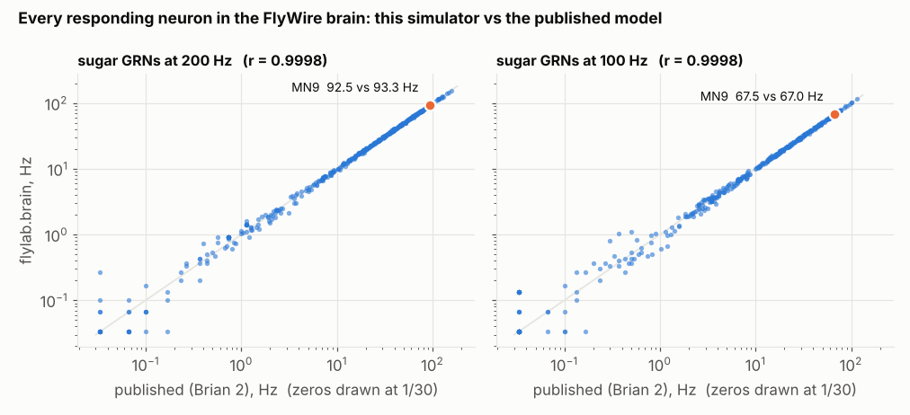

# Whole-CNS simulator — validation

`flylab/brain.py` re-implements the leaky integrate-and-fire model of
Shiu et al., *A Drosophila computational brain model reveals sensorimotor processing*,
Nature 634 (2024) — originally written in Brian 2 — in vectorised NumPy/SciPy, so that it can
run many trials in parallel and on a second connectome (MaleCNS). Three levels of evidence
that it is the same model:

## 1. Spike-for-spike identical to Brian 2 (unit tests)

`tests/test_brain.py::test_spike_times_identical_to_brian2` writes the published equations
directly in Brian 2 (exact linear integration, `(unless refractory)` state, delayed
`g += w` synapses, threshold/reset/refractory) and feeds both simulators the same input
events. On three random signed networks (40 neurons, 15–40% density, 150 ms), **every spike of
every neuron falls on the same 0.1 ms step**. CI installs Brian 2 so this runs on every push.

Getting to exact equality surfaced two Brian 2 semantics that a re-implementation from the
paper's equations alone would miss:

1. The refractory flag used by a step's state update is the one computed at the *previous*
   step's threshold, so a neuron stays frozen one step longer than a naive reading suggests.
2. Synaptic input arriving while the target is refractory is **dropped**, not accumulated.
   Both change the dynamics of strongly driven neurons.

The fast single-trial kernel (`run_trials`, active-set updates) is tested spike-for-spike
against the batched kernel.

## 2. Reproduces the authors' published simulations (FlyWire 630)

Shiu et al.'s repository ships their own Brian 2 outputs for the example experiment
(21 right-hemisphere sugar GRNs activated, 30 × 1 s trials). Same table, same conditions,
compared neuron by neuron (`experiments/harness/shiu_reproduction.py`,
`experiments/results/SHIU-REPRO/`):

| condition | MN9 (this) | MN9 (published) | active neurons | Pearson r, non-input neurons | top-50 responders shared |
|---|---|---|---|---|---|
| sugar 200 Hz | 92.5 ± 5.4 Hz | 93.3 Hz | 450 vs 448 | 0.99985 (n = 433) | 49 / 50 |
| sugar 100 Hz | 67.5 ± 5.4 Hz | 67.0 Hz | 406 vs 404 | 0.99978 (n = 402) | 50 / 50 |

Restricted to neurons below 20 Hz the correlation is still 0.9986–0.9987; the median absolute
per-neuron difference is 0.23–0.27 Hz, the size expected from different Poisson draws.

## 3. Performance

Single core, FlyWire 630 (127,400 neurons, 14.7 M connections), sugar GRNs at 200 Hz, 1 s of
simulated activity (10,000 steps): 9.8 s per trial with the active-set kernel (22.6 s with the
batched dense kernel). Trials parallelise across processes; 30 trials on 4 cores take ≈ 1.7 min.
MaleCNS (165,122 neurons, 25.6 M connections) costs more when activity spreads widely.

## What was checked about the inputs

- The sign rule was verified on Shiu et al.'s own table: GABA and glutamate neurons carry −1,
  acetylcholine, dopamine, serotonin and octopamine +1 (98.5% agreement with the later FlyWire
  transmitter release; the remainder are version changes in predictions).
- 20 of their 21 "sugar" GRN IDs appear in the published FlyWire annotation release
  (Schlegel et al. 2024), typed as LB3c (sugar, 9), LB3b (sugar/low salt, 2), LB4b (putative
  attractive, 4) and **LB3d (high salt / heavy metal, 5)**. This is a disagreement between
  annotation releases, not a demonstrated error, but it is why the cross-connectome
  experiment (EXP-W1-SUGAR) defines its input as LB3c only.
